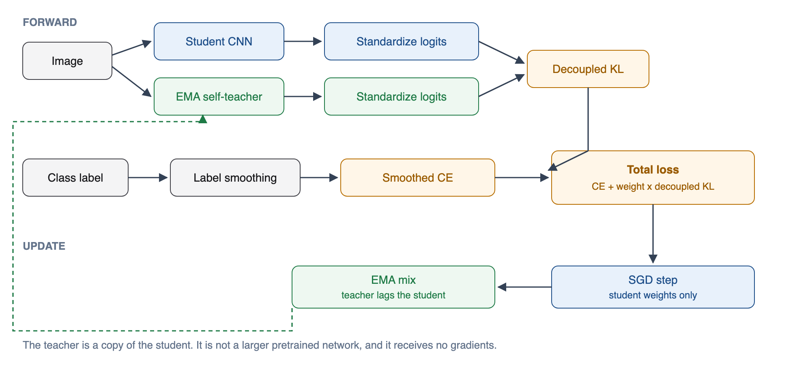
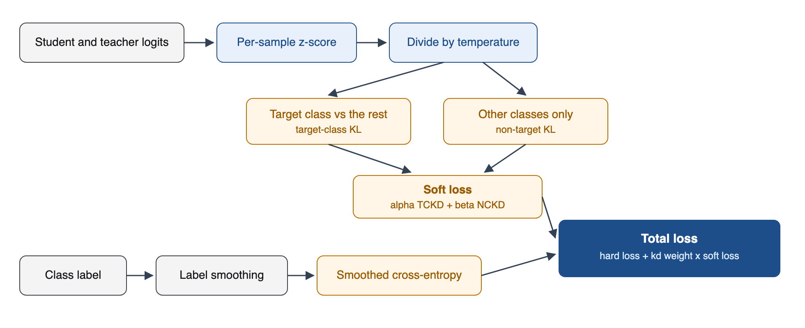
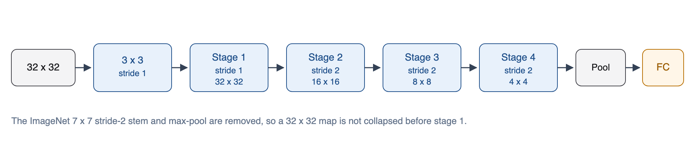

# Teacher-free knowledge distillation

Train a CNN from scratch on CIFAR-100 or ImageNet without a pretrained teacher. The only soft targets come from an exponential moving average of the network being trained. Hard labels are smoothed. Student and teacher logits are standardized, then compared with a KL that separates the labeled class from the other classes.

There is one student. The teacher is a copy of that student, not a larger model.

## Training architecture



The teacher is in eval mode and receives no gradients. After the student optimizer step, every floating-point parameter and buffer is mixed into the teacher:

```text
teacher = decay * teacher + (1 - decay) * student
```

`decay` defaults to `0.999`, so the teacher lags the student and stays smoother than the weights that just took a gradient step.

For the first warmup epochs the distillation weight is zero. The student learns from smoothed labels only, and the EMA still tracks it. After warmup the soft loss turns on. On CIFAR-100 that warmup is 20 epochs. On ImageNet it is 10.

## Loss



The total loss is

```text
L = CE(student, smoothed label) + kd_weight * (alpha * TCKD + beta * NCKD)
```

**Label smoothing.** With smoothing `ε` and `K` classes, the hard target is `(1 - ε)` on the true class and `ε / K` on every class, including a share of the true class. PyTorch's `cross_entropy(..., label_smoothing=ε)` implements that. Default `ε` is `0.1`. This is the fixed virtual teacher. It does not depend on another network.

**Logit standardization.** For each sample, logits are z-scored over the class dimension before the soft loss:

```text
z' = (z - mean(z)) / (std(z) + 1e-7)
```

Student and teacher are standardized separately. The ranking of classes is unchanged. The scale is, which keeps a confident EMA and a less confident student from dominating the KL. Pass `--no-standardize` to turn this off.

**Decoupled KL.** The soft loss is not one KL over all `K` classes.

- Target-class KL compares the binary probability of the labeled class against the probability of everything else.
- Non-target KL compares the softmax over the remaining classes. The labeled logit is masked out before that softmax.

Both terms are multiplied by `temperature²`. CIFAR-100 defaults are temperature `4`, `alpha = 1`, `beta = 8`. ImageNet defaults are temperature `1`, `alpha = 1`, `beta = 0.5`.

A baseline with the same optimizer and label smoothing, and no self-teacher, is `--kd-weight 0`.

## One training step


Evaluation uses the student, not the EMA. Top-1 accuracy is the fraction of validation images whose highest logit matches the label. `checkpoints/best.pt` stores the student, the EMA, the accuracy, and the arguments for the best epoch. `checkpoints/last.pt` is the latest epoch.

## Models

All five networks are the torchvision implementations, started with `weights=None`. The classifier is sized to the dataset: 100 classes on CIFAR-100, 1000 on ImageNet.

| Name | What it is | CIFAR stem |
| --- | --- | --- |
| `resnet18` | 18-layer residual net, basic blocks, stages 64-128-256-512 | 3x3 stride-1 conv, max-pool removed |
| `resnet50` | 50-layer residual net, bottleneck blocks `[3, 4, 6, 3]` | same |
| `resnext50_32x4d` | ResNet-50 with 32 grouped paths of width 4 | same |
| `mobilenet_v2` | Inverted residual blocks, depthwise spatial conv | first conv stride set to 1 |
| `shufflenet_v2_x1_0` | Channel split, depthwise conv, channel shuffle | first conv stride set to 1 |

ImageNet keeps the standard stem: a stride-2 first convolution, and a max-pool on ResNet and ResNeXt.

### CIFAR ResNet and ResNeXt

A 32x32 image cannot spare the ImageNet stem. That stem is a 7x7 stride-2 convolution plus a stride-2 max-pool, which would shrink the map to 8x8 before the residual stages. The CIFAR stem is a 3x3 stride-1 convolution and no max-pool. Spatial size through the residual stages:



ResNet-18 uses two basic blocks per stage. ResNet-50 and ResNeXt-50 use bottleneck blocks. ResNeXt replaces the middle 3x3 convolution with 32 groups.

### CIFAR MobileNetV2 and ShuffleNetV2

These stay the torchvision graphs. Only the first convolution changes, from stride 2 to stride 1, so the 32x32 map is not halved immediately. Later stride-2 blocks still downsample. On ImageNet the first convolution stays at stride 2 and the input is 224x224.

## Data

| Dataset | Train | Validation | Normalization |
| --- | --- | --- | --- |
| CIFAR-100 | random crop 32 with padding 4, horizontal flip | center, no crop | mean `(0.5071, 0.4867, 0.4408)`, std `(0.2675, 0.2565, 0.2761)` |
| ImageNet | random resized crop 224, horizontal flip | resize 256, center crop 224 | mean `(0.485, 0.456, 0.406)`, std `(0.229, 0.224, 0.225)` |

CIFAR-100 downloads into `--data` on first use. ImageNet is not downloaded. Point `--data` at a directory with `train/` and `val/` laid out as class folders.

## Optimizer

SGD with Nesterov momentum `0.9` and learning rate `0.1`. The learning rate follows a cosine schedule over the full run, with no restarts. Weight decay is `5e-4` on CIFAR-100 and `1e-4` on ImageNet. CIFAR-100 runs 200 epochs. ImageNet runs 100. Batch size defaults to 128.

The device is CUDA, then Apple MPS, then CPU, unless `--device` is set.

## Layout

```text
train.py            training loop, optimizer, checkpoints, CLI
tfkd/models.py      torchvision builders and the CIFAR stem
tfkd/ema.py         EMA self-teacher
tfkd/losses.py      standardization, decoupled KL, smoothed CE
tfkd/data.py        CIFAR-100 and ImageNet loaders
tests/test_losses.py
```

## Setup

```bash
python3.11 -m venv .venv
source .venv/bin/activate
pip install -r requirements.txt
```

## Train

CIFAR-100, ResNet-18:

```bash
python train.py --dataset cifar100 --model resnet18 --data data
```

The same command accepts `resnet50`, `resnext50_32x4d`, `mobilenet_v2`, and `shufflenet_v2_x1_0`.

ImageNet, ResNet-50:

```bash
python train.py --dataset imagenet --model resnet50 --data /path/to/imagenet --batch-size 256
```

One synthetic step, no download:

```bash
python train.py --dry-run --model resnet18
```

Loss and EMA tests, no dataset:

```bash
python -m unittest tests/test_losses.py
```

## Flags

| Flag | Default | Role |
| --- | --- | --- |
| `--dataset` | `cifar100` | `cifar100` or `imagenet` |
| `--data` | `data` | Dataset root |
| `--model` | `resnet18` | One of the five names above |
| `--epochs` | 200 / 100 | By dataset |
| `--batch-size` | `128` | |
| `--lr` | `0.1` | SGD learning rate |
| `--weight-decay` | `5e-4` / `1e-4` | By dataset |
| `--label-smoothing` | `0.1` | Virtual-teacher smoothing |
| `--kd-weight` | `1.0` | Scale on the soft loss. `0` disables it |
| `--kd-warmup-epochs` | 20 / 10 | Epochs before the soft loss turns on |
| `--temperature` | 4 / 1 | Softmax temperature |
| `--alpha` | `1.0` | Target-class KL weight |
| `--beta` | 8 / 0.5 | Non-target KL weight |
| `--ema-decay` | `0.999` | Teacher lag |
| `--no-standardize` | off | Skip logit z-scoring |
| `--seed` | `0` | |
| `--device` | `auto` | `auto`, `cpu`, `cuda`, or `mps` |
| `--dry-run` | off | One forward and backward on noise |

Dataset-specific defaults apply only when the flag is left unset.
